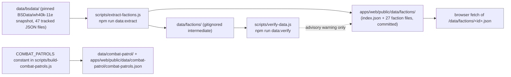

The web UI's unit, weapon, detachment, enhancement and Combat Patrol data does **not** come from
Postgres in the default dev/test experience. It comes from static JSON under
`apps/web/public/data/`, fetched directly by the browser
([Battle Mode Console & Roster Builder](../webapp/console-and-builder-components.md),
[API Client & Fallback Layer](../webapp/api-client-fallback-layer.md)). This page documents how
that JSON is produced and validated.

The governing policy, stated in the header of
[`scripts/verify-data.js`](../../scripts/verify-data.js#L1-L13) and
[docs/DEPLOYMENT.md](../../docs/DEPLOYMENT.md) §2 ("Catalog data: pinned snapshot (dev/test) vs
live source (release)"): **BSData is the primary authority; Wahapedia is an advisory
cross-reference.** The snapshot is refreshed deliberately, as a reviewed commit — not scraped at
runtime.

## Pipeline

### `scripts/extract-factions.js` (`npm run data:extract`)

Runs fully offline over the snapshot — no URLs, no CLI flags
([`scripts/extract-factions.js`](../../scripts/extract-factions.js#L4-L11)). Key behaviour:

- **Input**: every `*.json` in `data/bsdata/` except `Warhammer 40,000.json`, which is loaded
  separately only to index shared profiles/entries
  ([#L128-L133](../../scripts/extract-factions.js#L128-L133)).
- **Faction registry**: a hard-coded `FACTION_DEFINITIONS` array of the 27 canonical factions with
  `id`, `grandAlliance`, `primaryFile`, optional `libraryFile`/`isLegends`, and `subfactions[]`
  ([#L378-L633](../../scripts/extract-factions.js#L378-L633)).
- **Subfaction inheritance**: subfactions with their own BSData file (e.g. Space Marine Chapters)
  get full datasheets plus detachments extracted with the parent catalogue as library; fileless
  subfactions (Cadian, dynasties) inherit by reference
  ([#L676-L694](../../scripts/extract-factions.js#L676-L694)).
- **Detachments + DP cost**: groups matching `/^detachment/i`; the DP cost is read from the cost
  entry named "Detachment Points"/"DP" and defaults to **1**
  ([#L287-L288](../../scripts/extract-factions.js#L287-L288) — added with the DP-cost commit).
- **Enhancements** are extracted from `/enhancement/i` groups and mapped to detachments by
  comment↔name fuzzy match, group-name prefix, or a modifier JSON containing the detachment id
  ([#L300-L371](../../scripts/extract-factions.js#L300-L371)).
- **Leader linking**: the `Leader` ability is detected and its bullet list parsed into
  `attachableTo` ([#L235-L237](../../scripts/extract-factions.js#L235-L237),
  [#L79-L90](../../scripts/extract-factions.js#L79-L90)).
- **Weapon characteristics** resolve across catalogues through `targetId`/`entryLinks`/`infoLinks`
  with a global profile map, normalising Range/A/BS/WS/S/AP/D
  ([#L96-L197](../../scripts/extract-factions.js#L96-L197) — the fix for the earlier
  missing-characteristics bug).
- **Output is dual-written**: per-faction JSON + `index.json` go to **both** `data/factions/`
  (gitignored; the intermediate `data/factions/` copy was deliberately un-tracked as duplication)
  and `apps/web/public/data/factions/` (committed)
  ([#L726-L745](../../scripts/extract-factions.js#L726-L745)).

Output shapes: `index.json` entries carry `id, name, grandAlliance, isLegends, file,
datasheetCount, detachmentCount, subfactions`; faction files carry `detachments` (with `dpCost`,
`rules`, `enhancements`), `stratagems`, `subfactions`, `datasheets` (with `battlefieldRole`,
`basePoints`, `stats`, `weapons`, `isLeader`, `attachableTo`).

### `scripts/build-combat-patrols.js`

The seven official Combat Patrol lists are a **hard-coded constant in the script itself**
(`COMBAT_PATROLS`, authored against the Wahapedia Combat Patrol ruleset — there is no external
input), dual-written to `data/combat-patrol/` and `apps/web/public/data/combat-patrol/`
([`scripts/build-combat-patrols.js`](../../scripts/build-combat-patrols.js#L9-L15),
[#L595-L596](../../scripts/build-combat-patrols.js#L595-L596)). **No npm script invokes it** — it
is run manually with `node scripts/build-combat-patrols.js`. The dashboard's Combat Patrol tab and
"Deploy Patrol to Battle Mode" action consume the emitted JSON.

### `scripts/verify-data.js` (`npm run data:verify`)

Schema verification against the **gitignored** `data/factions/` copy as authority, with the web copy
only advisory ([`scripts/verify-data.js`](../../scripts/verify-data.js#L16-L17),
[#L47-L51](../../scripts/verify-data.js#L47-L51)). It exits 1 on a missing index or any error
(missing faction file, bad schema, non-positive toughness/wounds); incomplete weapon profiles are
warnings only. Two caveats:

- On a fresh clone `data/factions/` does not exist, so **`data:verify` fails until
  `data:extract` has been run** in that working tree.
- `data:verify` is **not part of any CI workflow, lint/build/test gate, or compose step** — see
  [Testing Strategy](../testing/testing-strategy.md). It is a manual gate.

## Docker and serving policy

- `.dockerignore` excludes `data/bsdata/` and `data/factions/` ("catalog data is
  development/test-only") but **no longer excludes `apps/web/public/data/`** — that exclusion was
  added and then reverted so the web image bundles the catalog
  ([`.dockerignore`](../../.dockerignore), [Deployment & Compose](../operations/deployment-and-compose.md)).
- `docker-compose.yml` (source-build stack) additionally bind-mounts `./apps/web/public/data`
  read-only into the web service so host regeneration is visible without rebuilding
  ([`docker-compose.yml`](../../docker-compose.yml#L83-L84)).
- **`docs/DEPLOYMENT.md` is stale on this point**: its catalog-policy section still claims release
  images exclude `apps/web/public/data/` and get data only via the live sync path. The current
  `.dockerignore` and compose mount contradict it; prefer the source files. The
  [Wahapedia ETL sync worker](../sync/wahapedia-etl-sync-worker.md) never wrote catalog tables
  anyway, so the "live source for release" path is aspirational in both versions.

## Working rules for changes here

- Regenerate, don't hand-edit: `apps/web/public/data/**` is generated output; edit
  `FACTION_DEFINITIONS`/extractors in `scripts/extract-factions.js` and re-run `npm run
  data:extract`, then `npm run data:verify` (after ensuring `data/factions/` exists), and commit
  the web copy. Exception: one-off repair scripts mutate the committed faction JSON in place —
  `scripts/audit-weapons-and-models.js` (reports missing weapon options/model counts against the
  BSData profile map), `scripts/heal-weapons-and-models.js` and `scripts/heal-unit-weapons.js`
  (write canonical weapon profiles and fixes back to `data/factions/` and
  `apps/web/public/data/factions/`; also not npm-scripted). If a heal script fixes something the
  extractor should produce, port the fix into `extract-factions.js` or the next
  `data:extract` re-breaks it.
- Legacy faction ids (`adeptus_astartes`, `tau_empire`, `necrons_szarekhan`,
  `chaos_space_marines`) are normalised to canonical file names by several client call sites; adding
  a faction means checking that normalisation in `lib/api.ts`, `RosterBuilder.tsx` and the console
  route.
- The hand-written client fixtures (`STARTER_DEMO_ARMY`, `FALLBACK_CATALOG_DATASHEETS`,
  `CORE_STRATAGEMS`) still duplicate a few of these facts and are not covered by `data:verify`.
