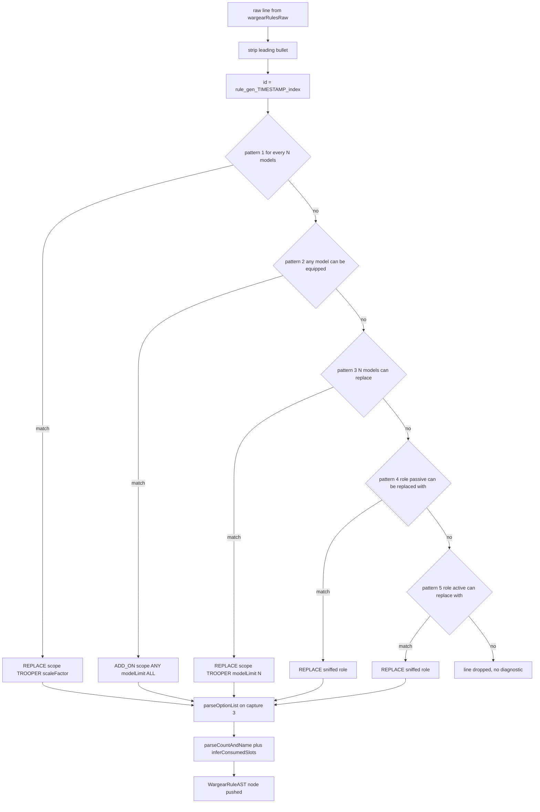
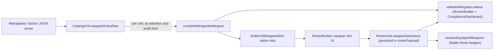

`packages/rules-engine-11e/src/wargear-parser.ts` (labelled §7.1 in the source header) is the
repository's only natural-language compiler: it turns the free prose a datasheet carries as
Wahapedia text — plain lines or raw HTML — into [`WargearRuleAST`](../../packages/types/src/index.ts#L128-L145)
nodes. It is a pure, single-pass, **line-oriented regex matcher**, not a grammar: one line of prose
in, at most one AST node out, and the whole rule model is whatever the five regexes happen to
capture. See [Rules Engine Overview](rules-engine-overview.md) for where this module sits among the
package's four, and [Data Model & Migrations](../data/data-model-and-migrations.md) for the catalog
tables the prose comes from.

Since the compiler landed it has grown a second, much larger responsibility: a **squad wargear
engine** (`buildUnitWargearSlots`, `validateWargearLoadout`, `resolveEquippedWeapons`,
`getUnitBaseModelThreshold`, `calculateUnitSquadPoints`) that models real 10e/11e squad model
thresholds, tier point pricing and tournament wargear limits. Unlike the regex compiler — which the
Battle Mode rewrite had stripped of all production callers — this squad layer is wired straight into
the browser: `RosterBuilder.tsx`, the Battle Mode route (`app/army/[id]/page.tsx`) and
`ComplianceDashboard.tsx` all import it, so changes here move what the console shows. The prose
compiler still feeds the pipeline (its ASTs seed the option lists the slot builder consumes); the
two halves are documented below.

## Entry point and input normalisation

`compileWahapediaWargear(rawTextOrHtml: string): WargearRuleAST[]` is exported from the package
barrel ([`src/index.ts`](../../packages/rules-engine-11e/src/index.ts#L2-L7)) and takes a single
string — no datasheet, no points table, no configuration. Its input is `CatalogUnit.wargearRulesRaw`,
which `RosterBuilder` builds by joining the `rawText` of every `wargearRules` row returned by
`GET /api/datasheets` with `\n`
([`RosterBuilder.tsx`](../../apps/web/src/components/RosterBuilder.tsx#L164-L186);
the rows come from `include: { wargearRules: true }` in
[`datasheets.ts`](../../apps/api/src/routes/datasheets.ts#L24-L38)), falling back to hard-coded demo
prose when the API returns nothing.

Before any matching happens the input is normalised
([`wargear-parser.ts#L74-L86`](../../packages/rules-engine-11e/src/wargear-parser.ts#L74-L86)):

1. ` ` and `</li>` become newlines; `<li ...>` becomes the literal bullet `• `;
2. every remaining tag is removed with `<[^>]+>` — attributes, entities and nested markup are simply
   deleted, so text inside a `` is concatenated with its neighbours on the same line;
3. the result is split on `\n`, each line trimmed, blank lines dropped;
4. per line, a leading `• ` is stripped again before matching.

Each surviving line is then tried against five patterns **in a fixed order**, and the first pattern
that matches wins (`return` inside the `forEach` callback). Rule ordering is therefore semantics:
a scale-factor line is tested before the numeric-count line, and the `ADD_ON` line is tested before
both role-targeted patterns, so a line that could plausibly satisfy two shapes always compiles to
the earlier one.

## The five recognised line patterns

| # | Pattern | Regex anchor | `ruleType` | `scope` | `constraint.maxSelections` |
| --- | --- | --- | --- | --- | --- |
| 1 | scale-factor replacement — "For every 5 models in this unit, 1 model can replace its boltgun with 1 Heavy Bolter" | `/(?:for every\|for each)\s+(\d+)\s+models.*?can\s+replace\s+(.*?)\s+with\s+(.*)/i` | `REPLACE` | `TROOPER`, `scaleFactor`, `modelLimit: 1` | the **string** `floor(unit.modelCount / N)` |
| 2 | add-on — "Any model can be equipped with 1 Combat Knife" | `/(?:any\|all\|each)\s+(?:model\|models?).*?(?:can\s+be\s+equipped\|may\s+take\|can\s+take)\s+(?:with\s+)?(.*)/i` | `ADD_ON` | `ANY`, `modelLimit: 'ALL'`, no `replaces` | `'ALL'` |
| 3 | numeric model count — "2 models can replace their boltgun with 1 Meltagun" | `/^(\d+)\s+models?\s+can\s+replace\s+(?:their\s+)?(.*?)\s+with\s+(.*)/i` | `REPLACE` | `TROOPER`, `modelLimit: N` | `N` (number) |
| 4 | role-targeted, passive — "The Sergeant's boltgun can be replaced with 1 Plasma Pistol" | `/^(?:the\s+)?([A-Za-z\s]+?)(?:'s)?\s+(.*?)\s+can\s+be\s+replaced\s+with\s+(.*)/i` | `REPLACE` | sniffed role + `rawRoleName`, `modelLimit: 1` | `1` |
| 5 | role-targeted, active — "The Champion can replace his bolt pistol with 1 Plasma Pistol" | `/^(?:the\s+)?([A-Za-z\s]+?)\s+can\s+replace\s+(?:their\|his\|her\|its)?\s*(.*?)\s+with\s+(.*)/i` | `REPLACE` | sniffed role + `rawRoleName`, `modelLimit: 1` | `1` |

Every pattern records the untouched original line as `rawText` (bullet and all), so the AST keeps a
pointer back to the prose it was inferred from. All regexes are case-insensitive and every capture
group is fed to the same three helpers, which is what makes the module small — and brittle.

*One prose line through HTML stripping, the ordered pattern chain, and the helper calls that build an AST node.*

## Helper semantics

- **`slugify(text)`** prefixes `wep_`, lowercases, collapses every non-alphanumeric run to `_`, and
  trims edge underscores: `Master-crafted Power Weapon` → `wep_master_crafted_power_weapon`. The
  slug becomes each option's `id`, so two option names differing only in punctuation collide.
- **`parseCountAndName(itemStr)`** trims, strips a leading `• `, and matches `^(\d+)\s+(.*)`; with no
  leading integer it returns `{ count: 1, name: <whole string> }`. It never singularises, so
  `"2 Storm Bolters"` keeps the plural name.
- **`parseOptionList(raw)`** first rewrites ` or ` / ` and/or ` into `, ` (case-insensitive), splits
  on commas, trims, drops empties **and any fragment starting with `1 of the following`**, then maps
  each fragment through `parseCountAndName` + `slugify`. It hard-codes `pointsDelta: 0` for every
  option. Plain ` and ` is *not* a separator, so the second line of the Terminator-squad fixture —
  `… with 1 Assault Cannon and 1 Power Fist or 1 Heavy Flamer and 1 Chainfist`
  ([`RosterBuilder.tsx#L60`](../../apps/web/src/components/RosterBuilder.tsx#L60-L60)) — yields two
  options named `Assault Cannon and 1 Power Fist` and `Heavy Flamer and 1 Chainfist` rather than
  four paired alternatives.
- **`detectTargetRole(roleName)`** is keyword sniffing over the captured subject noun, not a lookup:
  `sergeant|champion|leader|captain|aspiring` → `SERGEANT`, `chassis|hull|body` → `CHASSIS`,
  anything else → `TROOPER`. The unedited capture is still stored as `scope.rawRoleName`, which is
  what the UI prints. Because the subject group is lazy and `([A-Za-z\s]+?)` accepts spaces, the
  split lands on the *first* plausible whitespace: `The Sergeant's storm bolter can be replaced with
  1 Combi-weapon` yields `rawRoleName: 'Sergeant'` / `replaces: 'storm bolter'` (the `'s` is absorbed
  by the optional `(?:'s)?`), while `The Heavy Flamer can be replaced with 1 Onslaught Gatling
  Cannon` — a weapon, not a role — yields `rawRoleName: 'Heavy'` and a `replaces` name of just
  `Flamer`, scoped `TROOPER`.
- **`inferConsumedSlots(optionNames)`** scans option names against two keyword lists —
  `bolter|cannon|flamer|rifle|pistol|melta|plasma|las` for ranged and
  `sword|fist|hammer|axe|claw|blade|knife|maul` for melee — returning `['primary_ranged','melee']`
  when both hit, `['melee']` for melee only, and `['primary_ranged']` otherwise (including for an
  empty option list). Despite `ConsumedSlot` admitting `secondary_ranged` and `chassis_addon`
  ([`types/src/index.ts#L119`](../../packages/types/src/index.ts#L119-L119)), the compiler can only
  ever emit the other two — and nothing downstream reads the field at all.

## Invariants an editor must preserve

Three generated properties are load-bearing for consumers and are not enforced by types or tests:

- **`id` is `rule_gen_<Date.now()>_<lineIndex>`.** Structure is deterministic; identity is not.
  Recompiling the same text yields new ids, so any `wargearSelections` entry keyed by `ruleId` is
  invalidated by the next recompile — and selections are now persisted, which makes this a live
  hazard rather than a theoretical one (see "Where the ASTs land").
- **`pointsDelta` is always `0`.** Pricing is never derived from prose. The UI now prices units
  through `calculateUnitSquadPoints` (baseline × squad-tier multiplier) plus the caller's enhancement
  points instead of trusting option deltas, so a non-zero `pointsDelta` from a compile would still
  be ignored by point math.
- **Unmatched lines are dropped silently.** There is no error, warning, log, or "unknown" node type;
  a line that matches none of the five patterns simply produces no AST entry, and fully unrecognised
  input compiles to `[]` (asserted by
  [`wargear-parser.test.ts#L108-L111`](../../packages/rules-engine-11e/src/__tests__/wargear-parser.test.ts#L108-L111)).
  The UI cannot distinguish "this unit has no options" from "this unit's options failed to parse" —
  both render as *No configurable wargear options for this unit*.

## Failure modes visible in the repository's own prose

The demo/fallback corpus in the web app already contains lines the compiler mishandles, which is the
clearest statement of the pattern set's reach:

| Line | Where | What the compiler does |
| --- | --- | --- |
| `For every 5 models, 1 model can replace with 1 Assault Cannon and 1 Power Fist` | [`catalog/page.tsx#L39`](../../apps/web/src/app/catalog/page.tsx#L39-L39) | **dropped.** Pattern 1 needs `replace <X> with <Y>` with a non-empty `<X>`, but here the single ` with ` follows `replace` immediately, so `(.*?)\s+with\s+` can never settle; patterns 3–5 cannot match the `For every …` prefix either. |
| `All models can replace 2 Assault Bolters with 2 Plasma Exterminators` | [`catalog/page.tsx#L99`](../../apps/web/src/app/catalog/page.tsx#L99-L99) | matches pattern 5 with subject `All models` → scoped `TROOPER` with `modelLimit: 1` and `maxSelections: 1`, losing the "all models" quantity. |
| `Any model can be equipped with 1 Multi-melta instead of 1 Melta Rifle` | [`catalog/page.tsx#L75`](../../apps/web/src/app/catalog/page.tsx#L75-L75) | matches pattern 2, but `instead of` is not a grammar the parser knows: the option name becomes `Multi-melta instead of 1 Melta Rifle` and `replaces` stays `undefined`. |
| `Can be equipped with 1 Storm Bolter, 1 Multi-melta, and 1 Hunter-killer Missile` | [`catalog/page.tsx#L111`](../../apps/web/src/app/catalog/page.tsx#L111-L111) | **dropped.** Pattern 2 requires an `any`/`all`/`each` + `model` subject, and no other pattern admits `can be equipped`. |

The general rule for anyone touching the parser: widen a pattern or add a new one *before* the
existing ones only if you have checked that no currently-matching corpus line is stolen by it, and
add the offending corpus line as a test — there is no diagnostic that would otherwise tell you a
datasheet's prose stopped compiling.

## The squad wargear engine (production layer)

The functions below now do the real work in the browser; the prose compiler only seeds their
option lists. All are exported from the package barrel
([`src/index.ts`](../../packages/rules-engine-11e/src/index.ts)) and are pure functions over data
the caller supplies, in the package's "push data in" convention.

- **`getUnitBaseModelThreshold(unit)`** — infers the canonical tabletop baseline squad size from
  the unit *name*, battlefield role and keywords via ordered regex tiers, because raw BSData
  `modelComposition` often lists 1 model even for squads. Tiers, first-match-wins: explicit unique
  retinues (e.g. Calgar → 3, Gaunt's Ghosts → 6), single-model characters/vehicles/monsters,
  10-model hordes (cultists, Boyz, Tactical squads…), 4-model Custodes guards, 3-model elite
  fireteams (Aggressors, Crisis, Deathshroud…), **Terminators → 5 (scale to 10)**, then standard
  5-model infantry/battleline. Name-regex over keywords means a renamed datasheet silently falls to
  the next tier — the biggest fragility in this layer.
- **`calculateUnitSquadPoints({ basePoints, modelCount, baseModelCount, isCharacter, enhancementPoints })`** —
  tier pricing: `tierMultiplier = ceil(modelCount / threshold)`, so 6 models on a 5-man base pay
  the full 10-man price, and `isUnderstrength` flags off-tier counts. Characters and
  single-model units always pay `basePoints + enhancementPoints`. `RosterBuilder` stores the result
  in `RosterUnit.pointsCost`, which is what the API-side `POINTS_SHIFT` audit compares against
  `basePoints` ([Roster Validation](roster-validation.md)) — a mismatch between the engine's
  threshold table and the audit's expectation surfaces as AMBER discrepancies.
- **`buildUnitWargearSlots({ catalogWeapons, wargearRules, isLeader, modelCount, abilities, unitName, keywords })`** —
  produces the editable `WargearSlot[]` UI (categories `LEADER` / `SPECIAL` / `HEAVY` / `ADD_ON`):
  leader/bodyguard split, squad special & heavy slots (max 1 per 5 models, or per-model for heavy
  squads), trooper ranged swaps, melee alternatives, and support add-ons sniffed from unit
  abilities (e.g. Teleport Homer). It merges the compiled AST options with fallback slots derived
  from the catalog weapon list, so units with no parseable prose still get editable slots.
- **`validateWargearLoadout({ modelCount, wargearSelections, rules, catalogWeapons })`** — enforces
  the scale-factor and `maxSelections` constraints the old compiler only *displayed*: excess emits
  `WargearValidationError { severity: 'RED' }` tournament-limit messages. `RosterBuilder` runs it
  on every add/selection change, and `ComplianceDashboard` runs it per unit during the audit
  ([Console & Builder Components](../webapp/console-and-builder-components.md)).
- **`resolveEquippedWeapons(catalogWeapons, modelCount, selections, isLeader)`** — computes the
  `EquippedWeaponBadge[]` Battle Mode renders per unit: default baseline loadout scaled by model
  count, replaced-weapon deduction, and multi-profile firing modes (frag & krak) resolved together.
  The Battle Mode route (`app/army/[id]/page.tsx`) calls it with selections loaded from the persisted
  roster, falling back to `getUnitBaseModelThreshold` when `modelCount` is absent.
- **`normalizeBaseWeaponName` / `cleanDisplayName`** — strip firing-mode prefixes (`➤`, `•`) and
  suffixes (`- frag`, `- krak`, …) so slot construction and badges can group weapon variants.

## Where the ASTs land

*Prose is recompiled at selection/audit time; selections are now real state — persisted with the roster, validated client-side, and rendered as equipped-weapon badges.*

- `RosterBuilder` compiles per unit when a unit's wargear UI renders, when selections change, and
  during its batch revalidation pass, then feeds the AST to `buildUnitWargearSlots` and
  `validateWargearLoadout` ([`RosterBuilder.tsx`](../../apps/web/src/components/RosterBuilder.tsx)).
  Selections are stored on `RosterUnit.wargearSelections` using the typed
  `WargearSelection` shape (`ruleId` / `selectedOptionId` / `count`, plus the new optional
  `weaponName` / `replacesWeaponName` / `role` fields), and reach Postgres through the edit page's
  auto-save ([Roster Persistence workflow](../workflows/roster-persistence-and-offline-sync.md)).
  The `optionId` vs `selectedOptionId` shape split documented in earlier revisions of this page is
  gone: the local interface imports `WargearSelection` from `@forceorg/types` directly.
- `ComplianceDashboard` recompiles `catalogUnit.wargearRulesRaw` per unit and runs
  `validateWargearLoadout`, so RED tournament-limit errors show up in the audit modal client-side.
- The edit page offers a **"reset wargear to legal"** action (`onResetWargearToLegal`) that clears
  every unit's `wargearSelections` and `validationErrors`, sets `needsVerification: false`, and
  saves — the recovery path when persisted selections stop validating against a recompiled AST.
- `WargearSelection` is keyed by `ruleId = rule_gen_<timestamp>_<index>`, which changes on every
  recompile — yet selections now persist across sessions. Nothing yet rewrites old `ruleId`s on
  load, so replayed rosters validate against rules whose ids may not match the freshly compiled
  set; `validateWargearLoadout` tolerates this (unknown rule ids simply skip the AST checks), but
  the fallback slots built from catalog weapons are what make reloaded rosters still editable.
- Nothing persists ASTs. `WargearRule.conditionTree Json` in
  [`schema.prisma#L164-L177`](../../packages/db-client/prisma/schema.prisma#L164-L177) remains
  unread and unwritten; the live shape is still "store prose, recompile at read time."

## Test guardrails

[`__tests__/wargear-parser.test.ts`](../../packages/rules-engine-11e/src/__tests__/wargear-parser.test.ts)
(34 vitest cases, part of the suite the CI coverage gate runs — see
[CI/CD Pipelines](../operations/ci-cd-pipelines.md)) pins `slugify` output shape,
`parseCountAndName` count-defaulting and bullet stripping, `parseOptionList` comma/`or` splitting
with `1 of the following` filtering, each of the five prose patterns, multi-`<li>` HTML input, the
empty-array case for unrecognised text, and the squad layer: scale-factor excess as a RED error,
`resolveEquippedWeapons` baseline/replacement/firing-mode cases, `calculateUnitSquadPoints` tier
charging (6-on-5 pays 10-man), `getUnitBaseModelThreshold` across Terminator/elite/horde/character
categories, and support-gear slot derivation from abilities. It still asserts nothing about
`consumedSlots` inference, `pointsDelta`, or `rule_gen_` id instability, and the mis-parsing cases above are untested — so
those behaviours can change silently, while any change to the five patterns' captured
`scope`/`replaces`/`options`/`maxSelections` values will fail loudly.
