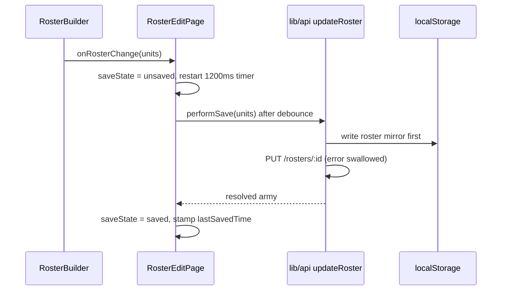

`apps/web` splits force construction and force play into two sibling client routes that share
components but never share state: `/army/[id]/edit` (the **Roster Studio**, "Edit Mode") and
`/army/[id]` (the **Battle Mode console**, "Battle Mode"). Both mount their own `ThemeProvider`
and `FactionSelector`, both mount a `ComplianceDashboard` modal, and both fall back to demo
fixtures (the dashboard's `STARTER_DEMO_ARMY`, the catalog page's `FALLBACK_CATALOG_DATASHEETS`)
so a missing API still renders a "working" screen. The Battle Mode route itself no longer
substitutes a demo army: an empty roster renders an explicit "No units in this battle force"
empty state linking to Edit Mode
([`apps/web/src/app/army/[id]/page.tsx#L650`](../../apps/web/src/app/army/[id]/page.tsx#L650)).
Routing and the guest session that make these pages reachable anonymously are covered by
[Web App Shell, Routing & Guest Session](./app-shell-and-guest-session.md); API fetches go
through [`apps/web/src/lib/api.ts`](../../apps/web/src/lib/api.ts), whose swallow-everything
fallbacks are documented in [API Client & Fallback Layer](./api-client-fallback-layer.md),
while faction-catalog data is fetched directly from
[`apps/web/public/data/factions/`](../data/catalog-data-pipeline.md). The canonical rules these
components imitate (leader attachment, wound allocation, stratagem gating)
live in `@forceorg/rules-engine-11e` — see
[Composite Units & Stratagem Filtering](../rules-engine/composite-units-and-stratagems.md) and
[Roster Validation](../rules-engine/roster-validation.md).

## Component map

| Component | Hosted by | Owns | Data source of truth |
| --- | --- | --- | --- |
| `RosterBuilder` | `/army/[id]/edit` | roster unit list, catalog drawer, multi-detachment 3 DP tray + enhancement reset, leader attachment, client-side totals | `apps/web/public/data/factions/<id>.json` fetched directly (see [Catalog Data Pipeline](../data/catalog-data-pipeline.md)) |
| `ComplianceDashboard` | `/`, `/army/[id]`, `/army/[id]/edit` | rules-audit modal, verdict banner, discrepancy filtering | `auditRoster` result, else arithmetic over props |
| `FactionSelector` | every page header | heraldry palette switch | `ALL_FACTION_PALETTES` (static) |
| `CreateArmyModal` | `/` | faction/detachment/name/size form → `createRoster` | `/data/factions/index.json` + per-faction JSON, with a fallback list on failure |
| `Skeleton`, `ErrorBoundary`/`InlineError` | app-wide | loading and render-failure presentation | n/a |
| `CompositeUnitCard`, `StratagemPanel`, `PhotoUploadModal` | **orphaned** — no route imports them | (wound tracking, phase stratagem directory, photo upload) | n/a — see "Orphaned components" below |

Battle Mode (`/army/[id]`) is implemented inline in its route file rather than through shared
components: the phase bar, CP counter, accordion unit cards and in-card stratagem lists all live
in [`apps/web/src/app/army/[id]/page.tsx`](../../apps/web/src/app/army/[id]/page.tsx).

The two pages also define the shapes that flow between them: `CatalogUnit` / `RosterUnit` /
`DetachmentOption` / `EnhancementOption` are exported from
[`RosterBuilder.tsx`](../../apps/web/src/components/RosterBuilder.tsx#L17-L60) and imported by
the console for typing, so the builder's payload shape is effectively the roster persistence
contract even though `lib/api.ts` also accepts a leaner offline shape.

## Edit mode: the Roster Studio route

[`apps/web/src/app/army/[id]/edit/page.tsx`](../../apps/web/src/app/army/[id]/edit/page.tsx)
is the only writer of roster payloads. It renders `FullPageSkeleton` while `fetchRoster` is in
flight, and if that call rejects it **synthesises a complete Ultramarines army object**
("Ultramarines Strike Force", Gladius Task Force, 2000 pts) rather than showing an error
([#L53-L72](../../apps/web/src/app/army/[id]/edit/page.tsx#L53-L72)).

The save loop is debounce-based:

The edit route's debounced auto-save, including the branch where a failed PUT is still
reported as saved. Caption: `performSave` is also invoked directly by the "Save Now" button and
by `handleThemeChange`.

`performSave` recomputes `totalPoints` from `pointsCost` but takes `detachmentPointsUsed` and
`selectedDetachments` straight from the existing `rosterPayload` (the DP total is owned by the
detachment tray, not derived from units), then calls `updateRoster`
([#L86-L109](../../apps/web/src/app/army/[id]/edit/page.tsx#L86-L109)). Because
[`updateRoster`](../../apps/web/src/lib/api.ts#L327-L370) writes localStorage *before* the PUT
and swallows the PUT failure, and the page's own `catch` also sets `saveState = 'saved'`,
**the "✓ Saved" pill can be shown while the server never accepted the roster**. The header pill
and the "Save Now" button are therefore progress indicators, not durability guarantees.

Two details matter when editing this page:

- `handleDetachmentChange` is a second writer alongside the debounced auto-save: when the
  RosterBuilder tray applies its staged detachments it fires
  `onDetachmentChange(primary, allSelectedDetachments, totalDp)`, and the page PUTs the new
  `detachmentPrimary`/`detachmentSecondary` plus the recomputed payload (including
  `rosterPayload.selectedDetachments` and the tray-supplied DP total) immediately; its `catch`
  likewise marks the save as saved
  ([#L137-L175](../../apps/web/src/app/army/[id]/edit/page.tsx#L137-L175)).
- `currentUnitsRef` mirrors the latest unit array so manual save and theme-save can reach it,
  but the `ComplianceDashboard` is handed
  `currentPoints={currentUnitsRef.current.reduce(...)}`
  ([#L289](../../apps/web/src/app/army/[id]/edit/page.tsx#L289)). Reading a ref during render is
  not reactive, so the audit's point total can lag the editor by one render.
- `FactionSelector` here is the only place in the app where a heraldry choice is persisted:
  `handleThemeChange` calls `performSave`, which sends `factionThemeOverride`. The console,
  catalog and dashboard treat the same control as ephemeral local state, so their theme choice
  is lost on navigation.

The edit route's `<main>` uses `className="layout-edit"`, which has no rule in
[`globals.css`](../../apps/web/src/app/globals.css#L318-L333); the full-width single-column look
comes from the inner `gridColumn: '1 / -1'` section, not from that class.

## RosterBuilder: faction catalog, detachments, enhancements

[`RosterBuilder.tsx`](../../apps/web/src/components/RosterBuilder.tsx) is a single component.
Its header comment calls it the "Full 11th Edition builder supporting all 27 canonical factions,
subfaction catalogue inheritance, detachment enhancements, and leader attachment"
([#L1-L6](../../apps/web/src/components/RosterBuilder.tsx#L1-L6)) — that is now accurate.

**Catalog comes from static faction JSON, not the API.** `loadCatalog` fetches
`${basePath}/data/factions/<normalizedId>.json` directly
([#L139-L152](../../apps/web/src/components/RosterBuilder.tsx#L139-L152)) — the committed
extractor output documented in
[Static Catalog Data Pipeline](../data/catalog-data-pipeline.md) — after normalising legacy
faction ids (`adeptus_astartes` → `imperium-space-marines`, `necrons_szarekhan` → `necrons`,
`tau_empire` → `t-au-empire`, `chaos_space_marines` → `chaos-chaos-space-marines`). Subfaction
datasheets (e.g. Blood Angels under Space Marines) are appended from `data.subfactions[]` when
the `subfactionId` prop matches
([#L171-L200](../../apps/web/src/components/RosterBuilder.tsx#L171-L200)). `dpCost` per unit
comes from `ds.detachmentPointsCost`, and `totalDP` is the sum over the roster
([#L248](../../apps/web/src/components/RosterBuilder.tsx#L248)). On fetch failure the drawer
shows "Loading faction armory..."/"No units found" — there is **no `DEMO_CATALOG` anymore**, so
an unreachable `/data/factions/` file yields an empty builder rather than demo units. The
wargear AST preview card (`WargearRuleCard`) and the `DEMO_CATALOG` name-join are gone, and
`wargearRulesRaw` is now populated from the faction JSON (`ds.wargearRules || ds.wargear ||
ds.wargearOptions`). The old "no frontend consumes the engine" state no longer holds:
**RosterBuilder imports the wargear/squad layer of `@forceorg/rules-engine-11e` directly** —
`compileWahapediaWargear`, `buildUnitWargearSlots`, `validateWargearLoadout`,
`resolveEquippedWeapons`, `calculateUnitSquadPoints`, `getUnitBaseModelThreshold` — so unit
model-count thresholds, squad-tier point costs and wargear limit errors are computed by the
engine in the browser ([Wargear AST Compiler & Squad Wargear Engine](../rules-engine/wargear-ast-compiler.md)).
`filterStratagems`, `allocateWound` and `validateRoster` remain server-side / inline-duplicated
([Composite Units & Stratagem Filtering](../rules-engine/composite-units-and-stratagems.md),
[Roster Validation](../rules-engine/roster-validation.md)).

**Multi-detachment console with a 3 DP budget tray.** A single-detachment dropdown was replaced
by a staged multi-select tray
([#L800+](../../apps/web/src/components/RosterBuilder.tsx#L800)). The header shows the active
detachment chips with their `dpCost` (defaulting to 1 when the catalog omits it) and a live
`activeTotalDp / dpLimit` meter; "Manage Detachments" opens a tray where
`handleToggleStagedDetachment` adds/removes detachments but refuses any toggle that would push
the staged total over `dpLimit` (default 3). Applying (`handleApplyDetachments`,
[#L667-L723](../../apps/web/src/components/RosterBuilder.tsx#L667-L723)) refuses an over-budget
staged set, unequips enhancements belonging to detachments that dropped out, resets those units'
`pointsCost` to `catalogUnit.basePoints`, then fires `onRosterChange` and
`onDetachmentChange(primary, stagedNames, stagedTotalDp)` so the edit page persists
`detachmentPrimary`/`detachmentSecondary` plus `rosterPayload.selectedDetachments` /
`detachmentPointsUsed` (see above). Enhancement options come from the combined pool of all active
detachments.

**Characters get enhancement and attachment selectors.** For units with role `CHARACTER`, each
expanded card renders a detachment-enhancement dropdown (choosing one reprices the unit via
`calculateUnitSquadPoints` with the enhancement's points,
[#L362-L400](../../apps/web/src/components/RosterBuilder.tsx#L362-L400))
and a "Attach to Bodyguard Unit" selector writing `attachedToInstanceId`
([#L814-L875](../../apps/web/src/components/RosterBuilder.tsx#L814-L875)). Removing a unit
unbinds anything attached to it ([#L275-L285](../../apps/web/src/components/RosterBuilder.tsx#L275-L285)).

**Client-side checks are display-only.** The summary bar turns the Points tile red over limit
and the Enhancements tile red above the 11e max of 3, but nothing blocks saving and there is no
Rule-of-Three warning block. `validationErrors` is now **populated**: model-count and wargear
selection changes re-run `validateWargearLoadout` and store the error messages on the unit
([#L471-L591](../../apps/web/src/components/RosterBuilder.tsx#L471-L591)), rendered inline on the
unit card and surfaced as RED discrepancies by the audit modal. Server-side roster validation
remains a separate path ([Roster Validation](../rules-engine/roster-validation.md)).

`initialUnits` is re-seeded into local state through an effect keyed on the prop
([#L120-L124](../../apps/web/src/components/RosterBuilder.tsx#L120-L124)). The edit page supplies
`(army?.rosterPayload as any)?.units || []`, so any roster whose payload lacks a `units` array
hands the builder a fresh array identity on every render and the effect overwrites in-component
edits back to that empty list.

## The catalog browser

[`apps/web/src/app/catalog/page.tsx`](../../apps/web/src/app/catalog/page.tsx) repeats the same
pattern one level up: it renders immediately from `FALLBACK_CATALOG_DATASHEETS` (eight curated
datasheets, [#L17-L114](../../apps/web/src/app/catalog/page.tsx#L17-L114)) and only swaps in
server rows when `fetchDatasheets` returns a non-empty array, falling back again on throw
([#L137-L152](../../apps/web/src/app/catalog/page.tsx#L137-L152)). Note
[`fetchDatasheets` itself](../../apps/web/src/lib/api.ts#L162-L210) already returns a
three-datasheet fixture on failure, so the page's own fallback is normally reached only for an
empty success, and the "Standby Catalog"-style disclosure does not exist here at all — the demo
cards are indistinguishable from real ones.

Two structural limits are visible in the source and shape user expectations:

- `selectedFaction` is hard-coded to `'adeptus_astartes'`
  ([#L134](../../apps/web/src/app/catalog/page.tsx#L134)) and nothing ever calls its setter; the
  `FactionSelector` in the header changes the *theme* only. The catalog therefore always queries
  Astartes datasheets regardless of the heraldry chosen.
- The detail modal's primary action is a `<Link href="/">` labelled "Add to Army via Studio"
  ([#L546-L552](../../apps/web/src/app/catalog/page.tsx#L546-L552)) — the catalog cannot add a
  unit to a roster; unit acquisition happens only inside `RosterBuilder`.

## Battle mode: the Tabletop Console route

[`apps/web/src/app/army/[id]/page.tsx`](../../apps/web/src/app/army/[id]/page.tsx) is a
self-contained Battle Mode HUD (its header comment lists the spec: "interactive Phase Bar, CP
Generator, Single-Accordion Force Org, Phase-Specific Datacards, and In-Card Phase Stratagems
(NO wound counters or health bars on cards)"
([#L1-L7](../../apps/web/src/app/army/[id]/page.tsx#L1-L7))). Data flow:

- `fetchRoster(armyId)` → `fetchDatasheets(factionId)`, plus a direct fetch of
  `/data/factions/<normalizedId>.json` to read the active detachment's `rules[]`, and
  `fetchStratagems({ detachmentId })` for detachment stratagems
  ([#L63-L115](../../apps/web/src/app/army/[id]/page.tsx#L63-L115)). Legacy faction ids are
  normalised the same way RosterBuilder does.
- `unitsList` returns `[]` for an empty payload — no demo-army substitution any more — and
  otherwise maps each persisted unit to a display unit, pairing leaders into composites
  client-side (`attachedToInstanceId` → merged weapons/abilities/keywords with Leader/Bodyguard
  origin tags) in the same spirit as
  [Composite Units & Stratagem Filtering](../rules-engine/composite-units-and-stratagems.md),
  but implemented inline in the route, not by calling the engine
  ([#L127-L254](../../apps/web/src/app/army/[id]/page.tsx#L127-L254)). An empty roster renders
  an explicit "No units in this battle force → Go to Edit Mode" state
  ([#L650](../../apps/web/src/app/army/[id]/page.tsx#L650)).
- Detachment context is banner-only: the active detachment rules render as a banner with a
  "Switch Detachment in Edit Mode →" link ([#L642](../../apps/web/src/app/army/[id]/page.tsx#L642))
  — switching is an Edit Mode action (see the RosterBuilder section above).

Battle state is all local `useState` and disappears on navigation like everything else here:
battle round (capped at 5, advancing grants +1 CP and resets to the Command phase,
[#L278-L286](../../apps/web/src/app/army/[id]/page.tsx#L278-L286)), command points with +/−
buttons and a "+ Generate CP" action
([#L264-L276](../../apps/web/src/app/army/[id]/page.tsx#L264-L276),
[#L467-L508](../../apps/web/src/app/army/[id]/page.tsx#L467-L508)), the active phase chosen from
a COMMAND/MOVEMENT/SHOOTING/CHARGE/FIGHT bar
([#L524-L560](../../apps/web/src/app/army/[id]/page.tsx#L524-L560)), and one expanded unit
accordion at a time. The active phase drives the datacards — an "Active <phase> Statline",
phase-focused weapon sections — and the in-card stratagem list
([#L720-L965](../../apps/web/src/app/army/[id]/page.tsx#L720-L965)). The stratagem pool is the
route's own 10-entry `CORE_STRATAGEMS` constant plus API detachment stratagems de-duplicated by
id ([#L23-L34](../../apps/web/src/app/army/[id]/page.tsx#L23-L34),
[#L257-L262](../../apps/web/src/app/army/[id]/page.tsx#L257-L262)); spending CP on one is a
local counter decrement with an insufficient-CP toast, not engine validation — the server-side
gate lives in `stratagem-filter.ts`
([Composite Units & Stratagem Filtering](../rules-engine/composite-units-and-stratagems.md)).
The ComplianceDashboard mounted here now receives real DP
(`currentDp = rosterPayload.detachmentPointsUsed`,
[#L990-L999](../../apps/web/src/app/army/[id]/page.tsx#L990-L999)).

## Orphaned components: CompositeUnitCard, StratagemPanel, PhotoUploadModal

No route imports
[`CompositeUnitCard.tsx`](../../apps/web/src/components/CompositeUnitCard.tsx),
[`StratagemPanel.tsx`](../../apps/web/src/components/StratagemPanel.tsx) or
[`PhotoUploadModal.tsx`](../../apps/web/src/components/PhotoUploadModal.tsx) any more — the
Battle Mode rewrite removed the wound-tracker cards and the phase-tab stratagem overlay they
provided. `CompositeUnitCard` still imports `PhotoUploadModal` internally, so the trio forms a
dead subgraph. Consequences for change planning:

- **Wound tracking has no UI.** The per-model wound-allocation matrix (and the haptics, the
  `DESTROYED` rendering and the persistence caveats previously documented here) is unreachable
  code. Canonical allocation semantics remain specified in
  [Composite Units & Stratagem Filtering](../rules-engine/composite-units-and-stratagems.md).
- **Photo upload has no UI entry point** even though the API path is live end-to-end
  ([Media Upload & Object Storage](../api/media-upload-and-object-storage.md));
  `uploadMiniaturePhoto`/`deleteMiniaturePhoto` in `lib/api.ts` have no caller.
- `StratagemPanel`'s `CORE_STRATAGEMS` (seven entries) is a **third copy** of core stratagems
  alongside the Battle Mode route's ten-entry constant and the fixtures in `lib/api.ts`;
  do not assume edits to one propagate.

## ComplianceDashboard: server audit first, arithmetic second

[`ComplianceDashboard.tsx`](../../apps/web/src/components/ComplianceDashboard.tsx) owns the
"Rules Audit" modal mounted by the dashboard, the console and the studio.

`runAudit` fires whenever `isOpen` becomes true and on every Re-Audit click. It calls
`auditRoster(rosterId)` and takes the server discrepancies as the base list; only if that
**throws** does it add its own `POINTS_SHIFT`/`DP_VIOLATION` RED fallbacks from props. The result
is stamped with a hard-coded `rulesetVersionCompared: '11.1.0-2026-Q3-MFM'`
([#L44-L141](../../apps/web/src/components/ComplianceDashboard.tsx#L44-L141)). Regardless of
whether the server audit succeeded, it then **appends a client-side wargear audit over the new
`units` prop**: per unit it flags `needsVerification` as an AMBER `INVALID_LOADOUT` advisory,
surfaces each stored `validationErrors` string as RED, and otherwise — when the unit has
`wargearSelections` — re-runs `compileWahapediaWargear` + `validateWargearLoadout` from
`@forceorg/rules-engine-11e` and pushes each tournament-limit violation as RED
([#L91-L131](../../apps/web/src/components/ComplianceDashboard.tsx#L91-L131)). The Battle Mode
console feeds it `rosterPayload.units`; only the studio passes `units` + `onResetWargearToLegal`
(the latter clears every unit's selections and re-saves). Note
[`auditRoster`](../../apps/web/src/lib/api.ts#L390-L419) catches its own failure and returns a
synthesised result, so the component displays *some* verdict even with no server at all.

Presentation logic:

- `isFullyCompliant = discrepancies.length === 0`; `isBattleLegal = redViolations.length === 0`.
  Three banners follow — "Battle-Ready (100% Compliant)", "Legal With Advisory Warnings",
  "Illegal Roster — Action Required" — driven by `RED` vs `AMBER` severity
  ([#L160-L226](../../apps/web/src/components/ComplianceDashboard.tsx#L160-L226)). The client-side
  wargear audit now produces both RED (loadout violations) and AMBER (`needsVerification`), so the
  banner verdict is no longer purely server-driven.
- Summary tiles (Violations, Advisories, Points Limit, DP Quota) and category tabs
  `ALL / POINTS_SHIFT / DP_VIOLATION / INVALID_LOADOUT`
  ([#L256-L283](../../apps/web/src/components/ComplianceDashboard.tsx#L256-L283)) filter locally.
- The "⚡ Sync Active Points (1-Click)" action renders only when there is at least one
  `POINTS_SHIFT` discrepancy **and** `onAutoFixPoints` is supplied
  ([#L369-L381](../../apps/web/src/components/ComplianceDashboard.tsx#L369-L381)). No call site in
  the app passes that prop, so the fix button is unreachable today, `handleApplyFix` never runs,
  and the `updateRoster` import at the top of the file
  ([#L9](../../apps/web/src/components/ComplianceDashboard.tsx#L9)) is unused.
- Callers differ in what they feed it: the dashboard and the Battle Mode console pass payload
  totals (`totalPoints`/`rosterPayload.totalPoints`, `detachmentPointsUsed`), and the studio
  passes a ref-derived total.

## Loading and failure conventions

The app has no route-level `loading.tsx`/`error.tsx`/`not-found.tsx` files
([Web App Shell](./app-shell-and-guest-session.md)); the convention is component-local:

- [`Skeleton.tsx`](../../apps/web/src/components/Skeleton.tsx) exports the primitive plus three
  presets. `FullPageSkeleton` is the route-level loading state used by the dashboard (during auth),
  the studio and the Battle Mode console; the dashboard also renders raw `Skeleton` rows while
  armies load. `UnitCardSkeleton` and `RosterListSkeleton` are exported but have no call sites.
- [`ErrorBoundary.tsx`](../../apps/web/src/components/ErrorBoundary.tsx) is mounted once in the
  root layout; its "Try Again" button only clears the stored error, and it catches render errors,
  not fetch errors. `InlineError` now has exactly one remaining call site — the orphaned
  StratagemPanel's core-rules notice — so no live page surfaces fetch degradation in the UI.
- Consequently **no live page in this surface has a failure state**: every fetch failure is
  converted into fixture data or an empty list plus a `console.warn`. The Playwright suite still
  passes with the API offline because its journey goes dashboard (`STARTER_DEMO_ARMY`) → Battle
  Mode accordion, where "Captain in Terminator Armour" comes from the dashboard fixture's roster
  payload and the audit verdict from `auditRoster`'s synthesised result
  ([`e2e/critical-flows.spec.ts#L56-L95`](../../apps/web/e2e/critical-flows.spec.ts#L56-L95)).

## Force creation entry point

[`CreateArmyModal.tsx`](../../apps/web/src/components/CreateArmyModal.tsx) is the only writer of
roster metadata before the studio exists. It now **fetches the faction list from
`/data/factions/index.json` and per-faction detachments/subfactions from
`/data/factions/<id>.json`** ([#L73-L130](../../apps/web/src/components/CreateArmyModal.tsx#L73-L130)),
falling back to a hard-coded short list on failure, and selecting a faction auto-picks its first
detachment, subfaction and a generated army name. Detachment step 2 is now a **multi-select card
grid with a live DP budget meter**: `handleToggleDetachment` blocks adding a detachment whose
`dpCost || 1` would push the selection over 3 DP, and submit re-validates non-empty selection and
the 3 DP ceiling. Submission sends `detachmentPrimary` (first pick), `detachmentSecondary`
(second pick), `pointsLimit`, `detachmentPointsLimit: 3`, and a seed `rosterPayload` carrying
`detachmentPointsUsed` and `selectedDetachments`, then navigates to `/army/<id>/edit` — the
studio, so a new force opens in edit mode; unlike the earlier
version it shows an error banner instead of synthesising a local army when `createRoster`
rejects (though `createRoster` itself rarely can — it writes localStorage first). The result is
that a "created" army may still exist only in one browser's localStorage while the UI behaves as
if it is a server resource; the studio and console then load it through the same localStorage
path.

## Working rules for changes here

- Catalog facts now have **one generated source** — `apps/web/public/data/factions/` (see
  [Catalog Data Pipeline](../data/catalog-data-pipeline.md)) — consumed directly by
  RosterBuilder, Battle Mode and CreateArmyModal. The remaining hand-written duplicates are
  `STARTER_DEMO_ARMY` (dashboard), `FALLBACK_CATALOG_DATASHEETS` (catalog page), the Battle Mode
  route's `CORE_STRATAGEMS`, and the fixtures inside `lib/api.ts`; changes to canonical units or
  stratagems must be reconciled against those too or the offline UI will contradict the catalog.
- The Battle Mode rewrite deleted the wargear AST preview and wound-tracking UIs, but the engine's
  wargear/squad layer is live in the browser again: RosterBuilder, Battle Mode and
  ComplianceDashboard import it for slots, validation, equipped-weapon badges and squad pricing
  ([Wargear AST Compiler & Squad Wargear Engine](../rules-engine/wargear-ast-compiler.md)).
- Renaming Battle Mode chrome (`BATTLE MODE` badge, `Command Points`, `Legal <phase>
  Stratagems`, Edit Mode/Battle Mode links) breaks the rewritten Playwright journey — test 04
  asserts on exactly those strings ([Testing Strategy](../testing/testing-strategy.md)).
